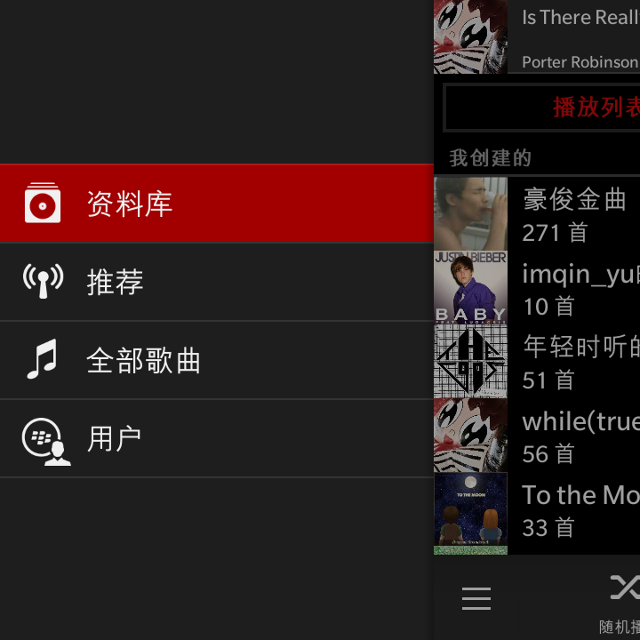
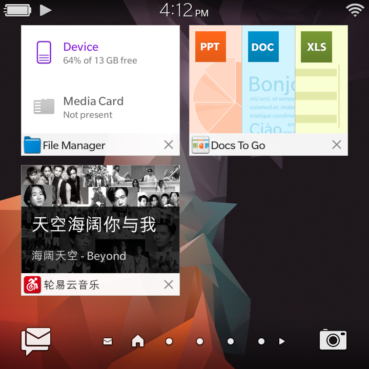
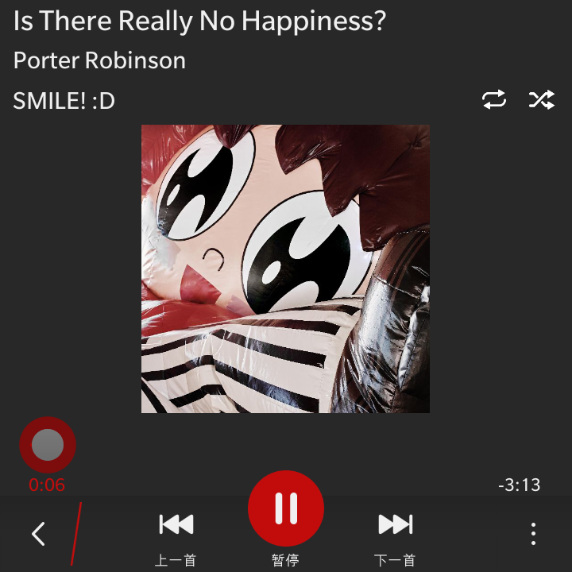
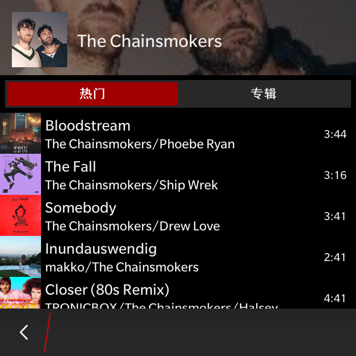
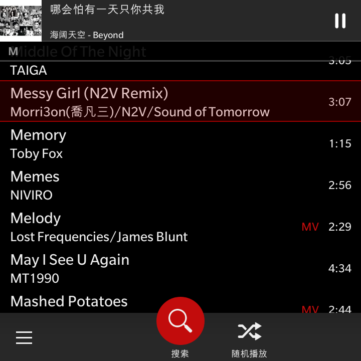
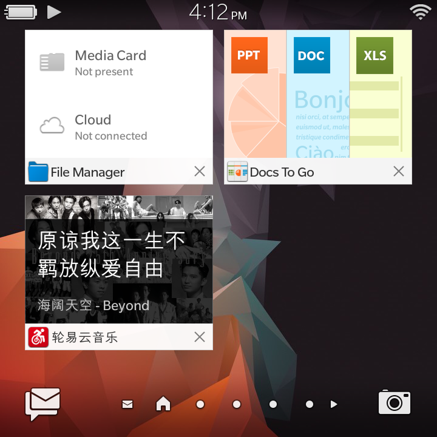
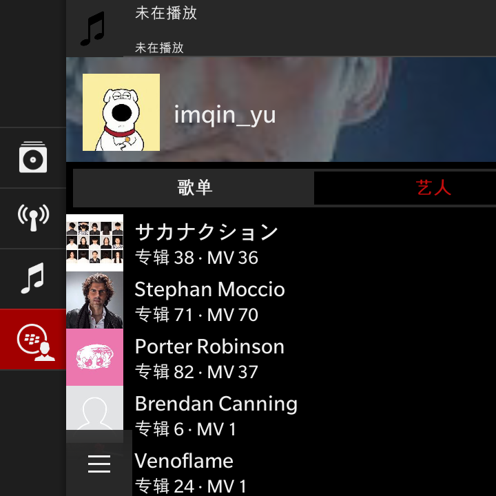

# LunYiYun Music: A Native NetEase Cloud Music Third-Party Client for BlackBerry

## Overview

Built on the BlackBerry Cascade framework, tested on BlackBerry Q20 and Z10.

Currently in testing phase, with many features and bug fixes still pending.

This is jailbreak software. You must jailbreak your BlackBerry before installing.

Currently supported:

- Play songs
- Load playlists
- Search songs
- Local caching
- Load followed artists

Icon inspired by: [HomasWSC](https://space.bilibili.com/12722558)

## Screenshots

Library

Now Playing

Artist Page

All Songs View

Recent Tasks

User Page

## Development Team

- UI Prototype / QA: Fremantle
- Programming / UI Implementation: Hy4, Hy3, Deepseek V4.1, Kimi K3, ChatGPT 6
- Icon Design: ChatGPT

## Acknowledgements

In no particular order

- Oleksandr: Provided jailbreak exploits and tools
- Pablo from WaitBerry: Provided reference documentation
- Github NeteaseCloudMusicApiEnhanced project: Provided NetEase Cloud Music API
- Anwar Ludin, Davenson Lombard: Provided free BlackBerry development tutorials
- And all my AI friends who supported me