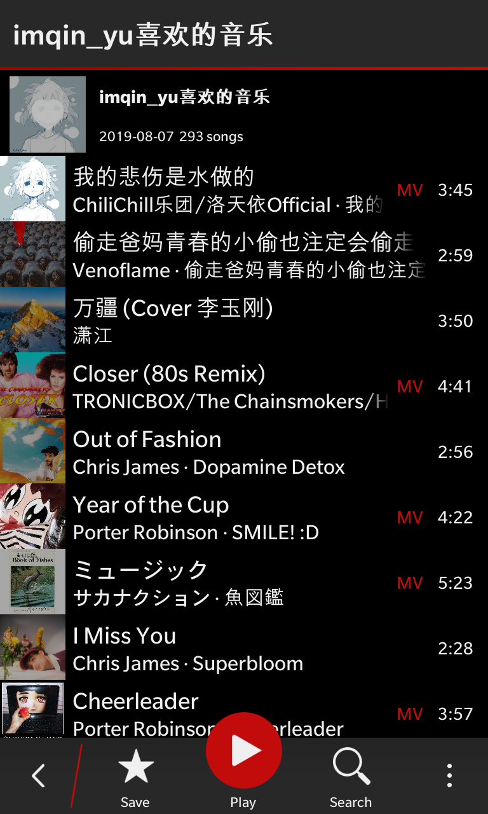
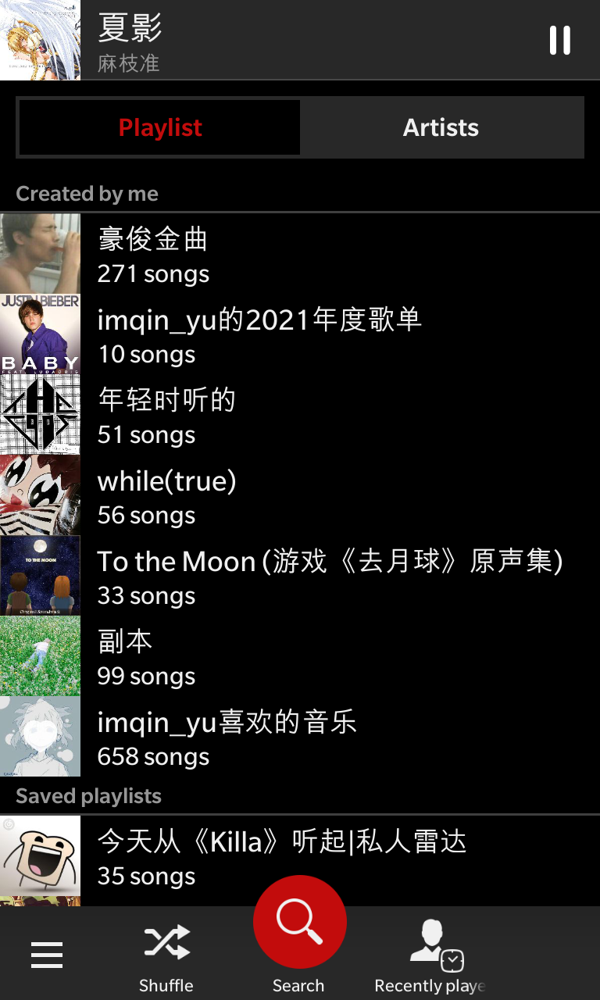

# 网易云音乐 BB10 性能排查与修复（2026-11-14）

修复版本：1.0.8（BAR manifest 为 1.0.8.1）。已安装到本次使用的 BB10 模拟器，并实际验证播放、打开歌单、滚动和返回首页。基线源码为 Git `669b5fb`；模拟器原安装版本为 1.0.6.1。

## 根因与修改

图片下载完成后，原 `NmImageCache::onFinished()` 在界面线程中完整解码图片、缩放并编码 JPEG。大封面会长时间占用事件循环。同时，图片完成通知会触发界面绑定刷新，随后一次遍历多个列表模型，增加输入和布局处理的等待时间。

- `src/nm/util/NmImageCache.cpp/.hpp`：用 `QtConcurrent::run` 和 `QFutureWatcher` 在后台解码、缩放及保存；优先通过 `QImageReader::setScaledSize` 缩小解码尺寸。下载与处理共用两个并发名额，完成后才将临时文件重命名为缓存文件。用 generation 隔离清缓存前的旧任务，恢复已有零字节缓存，缓存目录只解析一次。
- `src/MusicController.cpp/.hpp`：合并图片完成通知，将 12 个 ArrayDataModel 和 2 个 GroupDataModel 的刷新分批执行，每批最多 64 条、约 4 ms；批次间通过 QTimer 让出事件循环。滚动期间推迟模型更新。
- `tests/image-cache.pro`、`tests/test_image_cache.cpp`、`tools/test-image-cache.ps1`：增加可执行回归验证。
- `bar-descriptor.xml`：升级到 1.0.8；`.gitignore`：忽略本次临时构建和诊断目录 `/tmp/`。

遵循 BB10 Cascades 的原生列表原则：保留 `ListView`、委托和原有导航，更新模型副本并替换发生变化的项，分批时重新读取模型长度；不重建整张列表。

## 同条件压力测试

使用 Momentics 的 qconn 调试通道，在同一模拟器隔离运行原版与修复版图片缓存。24 个不同 URL 均返回相同的 4096×4096 JPEG（每张 12,696,141 字节），缓存从空开始，并发为 2；界面线程运行 10 ms 心跳，记录实际回调间隔。

| 指标 | 原代码 | 修复后 |
|---|---:|---:|
| 成功缓存图片 | 24 | 24 |
| 总时间 | 19,421 ms | 6,298 ms |
| 最长事件循环间隔 | 5,249 ms | 253 ms |
| P95 事件循环间隔 | 635 ms | 104 ms |

最长间隔降低约 95%，总时间降低约 68%。总时间包含最后一张图片完成后的约 200 ms 收尾等待。以上是大图压力场景的事件循环指标，不是实际页面响应时间、FPS 或音频延迟；本次没有采集 Momentics CPU profiler 调用树。它直接验证了图片处理造成的界面阻塞得到明显改善，仍存在 253 ms 峰值，不能据此声称所有卡顿都已消失。

原始结果保存在 [原版压力日志](performance-evidence/baseline-bench.log) 和 [修复后压力日志](performance-evidence/fixed-bench.log)。构建、安装与回归证据见 [模拟器构建](performance-evidence/final-simulator-build.log)、[ARM 构建](performance-evidence/device-release-build.log)、[安装日志](performance-evidence/final-install.log) 和 [回归结果](performance-evidence/test-results.txt)。

## 已完成的验收

1. `Simulator-Debug` 与 `Device-Release` 构建成功；两个 BAR 均通过 `blackberry-barchecker`，退出码 0；manifest 为 1.0.8.1，均包含 `native/assets/main.qml`。
2. 先停止旧应用，再安装并启动模拟器 1.0.8.1。实际打开 163 首歌单并滚动，播放《You》并返回首页；播放期间打开另一歌单（接口实际返回 293 首，首页旧元数据为 658）并滚动，返回首页后看到自动切到《夏影》，播放状态继续显示。
3. 图片缓存回归：7 passed、0 failed、0 skipped（包含初始化、清理以及 5 个测试场景）。覆盖缩放和磁盘复用、处理中清缓存并重载、坏响应、零字节缓存恢复、超限响应拒绝。超限测试的网络 abort 警告为预期现象。
4. `git diff --check` 通过。技能静态检查基线与修复版均为 14 error、24 warning，没有新增命中；原有 import 版本、HTTPS 和注释误命中等仍保留，静态检查整体未通过。





### 可执行验证命令

在 PowerShell 中运行：

```powershell
Set-Location D:\BBWorkspace\NeteaseMusic
powershell -NoProfile -ExecutionPolicy Bypass -File .\tools\test-image-cache.ps1
# 期望：7 passed, 0 failed, 0 skipped。
# 结果文件：tmp\image-cache-tests\test-results.txt

$env:QNX_HOST = 'C:\NDKFiles\host_10_3_1_12\win32\x86'
$env:QNX_TARGET = 'C:\NDKFiles\target_10_3_1_995\qnx6'
$env:PATH = "$env:QNX_HOST\usr\bin;$env:PATH"
& "$env:QNX_HOST\usr\bin\make.exe" -j4 Simulator-Debug
& "$env:QNX_HOST\usr\bin\make.exe" -j4 Device-Release
# 期望：两个构建退出码均为 0。

# SDK 打包/校验必须使用旧 Java，并将 NDK bin 放入 PATH。
$env:PATH = "F:\QDE\bbndk\features\com.qnx.tools.jre.win32.x86_64_1.7.0.51\jre\bin;$env:PATH"
Add-Type -AssemblyName System.IO.Compression.FileSystem
foreach ($package in @('NeteaseMusic-1.0.8-simulator.bar', 'NeteaseMusic-1.0.8-device.bar')) {
    $archive = [IO.Compression.ZipFile]::OpenRead((Join-Path $PWD $package))
    try { $archive.Entries | Where-Object FullName -eq 'native/assets/main.qml' | Select-Object FullName }
    finally { $archive.Dispose() }
}
# 期望：两个包均列出 native/assets/main.qml。
# 本机 nativepackager -list 接受打包描述输入，不能直接列出既有 BAR，故读取 ZIP 目录。
& "$env:QNX_HOST\usr\bin\blackberry-barchecker.bat" -platformArchitecture x86 .\NeteaseMusic-1.0.8-simulator.bar
& "$env:QNX_HOST\usr\bin\blackberry-barchecker.bat" -platformArchitecture armle-v7 .\NeteaseMusic-1.0.8-device.bar
# 期望：两个校验退出码均为 0。
```

## 风险与待确认

- 真机 ARM 包已构建及校验，但没有安装到 Q20，也没有测量真机性能。真机验收应在播放时打开大歌单，连续上下滚动、切换歌曲并返回首页，观察触摸响应、封面显示和播放是否连续；再在设置中清图片缓存，确认封面重新加载且没有旧任务回写。
- 默认缓存拒绝超过 16 MiB 的响应、超过 64×1024×1024 像素的源图以及无法解码的内容。这些图片保留占位图；失败 URL 在清缓存前不会反复请求。
- 滚动中封面可能延后到停止滚动才出现；这减少模型更新与滚动布局争用。
- 约 4 ms 是批次预算检查，不是严格上限；单次模型更新与全局绑定通知仍可能超过预算。
- 本次针对图片处理和模型刷新瓶颈。网络慢、其他页面的解析或布局开销、长时间内存增长尚未做完整剖析。

安装包位于工程根目录：`NeteaseMusic-1.0.8-simulator.bar` 和 `NeteaseMusic-1.0.8-device.bar`。本次未提交或推送 Git 变更。
